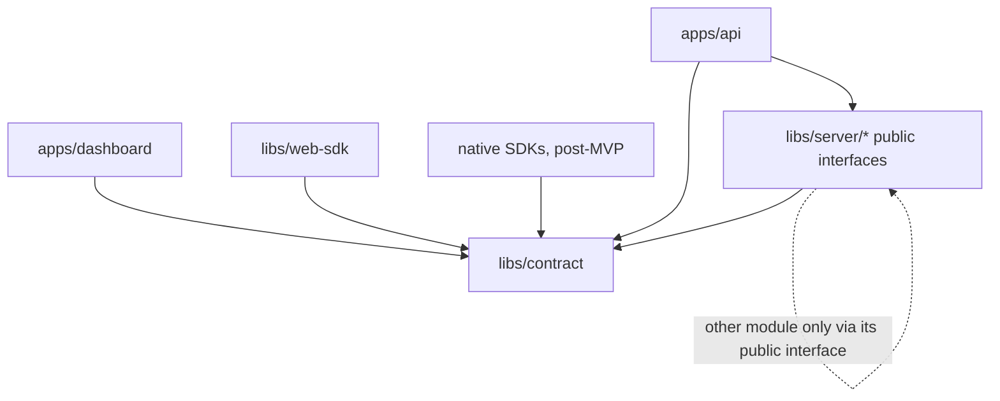
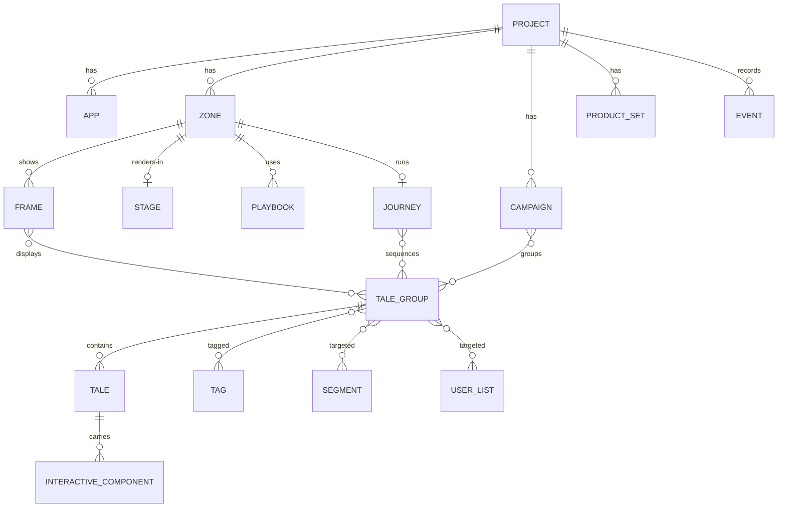

# Architecture Spine — TaleArt

## Design Paradigm

A **modular monolith**: one deployable API process and one PostgreSQL database, split into domain modules that each own their tables and expose a public interface. Edges are ports and adapters: HTTP adapters in `apps/api`, a storage port for media, and the another tool client inside the importer.

| Layer | Lives in |
| --- | --- |
| HTTP adapters (Management API, Delivery API), worker | `apps/api` |
| Domain modules (logic + tables + public interface) | `libs/server/<module>` |
| Shared contract (OpenAPI, generated types, schemas, event names, status map) | `libs/contract` |
| Clients | `apps/dashboard`, `libs/web-sdk`; post-MVP `libs/android-sdk`, `libs/ios-sdk`, `libs/mobile-sdk` |

## Invariants & Rules



Clients never import `libs/server`. Modules never import `apps/*`.

### AD-1 — Modular monolith `[ADOPTED]`

- **Binds:** all
- **Prevents:** an early split into services, and modules reading or writing each other's tables.
- **Rule:** One deployable API and one PostgreSQL database. Each domain module is an Nx lib under `libs/server/` and owns its tables. Another module reaches them only through that module's public interface. Nx module-boundary lint tags enforce the direction in the diagram above.

### AD-2 — Two API surfaces

- **Binds:** R9, R10, FR-002, FR-003, FR-009
- **Prevents:** SDK credentials reaching content writes, and web and native clients using different data paths.
- **Rule:** The Management API (`/api/v1`) serves the dashboard, accepts sessions only, and reads and writes. The Delivery API (`/delivery/v1`) serves every SDK, web and native, accepts zone keys only, reads published content, and writes events. No client reads the database or a module directly.

### AD-3 — Contract first `[ADOPTED]`

- **Binds:** dashboard, web-sdk, native SDKs, api
- **Prevents:** request and response shapes drifting between server and clients.
- **Rule:** The OpenAPI 3.1 document in `libs/contract` is the source of truth for both APIs. TypeScript types are generated from it. Native SDKs generate from the same document. A shape change starts in the document.

### AD-4 — Project-scoped shared schema

- **Binds:** R8, FR-001, FR-004, FR-030
- **Prevents:** data leaking across projects, and a backfill when usage metering arrives.
- **Rule:** One shared schema. Every content, zone, frame, targeting (tag, segment, user list), campaign, product set and event table has `project_id uuid NOT NULL` referencing `projects`. A module checks every project it acts on against the caller's credential. It never trusts a `project_id` it has not authorized.

### AD-5 — Frame types are data `[ADOPTED]`

- **Binds:** R10, R11, FR-006, FR-007
- **Prevents:** a migration per frame type, and web and native renderers disagreeing on settings.
- **Rule:** A frame row stores `type` (a registry key) and `settings` (JSONB). Each type has a JSON Schema in `libs/contract`, and the API validates `settings` against it on write. A new type is a registry entry, a schema and a renderer, with no migration. Clients skip frame types they don't know instead of failing.

### AD-6 — Status keys `[ADOPTED]`

- **Binds:** tales, tale groups, importer
- **Prevents:** modules storing different representations of the same status.
- **Rule:** The status key (`live`, `scheduled`, `processing`, `invalid-media`, `paused`, `blocked-by-group`, `expired`, `quota-reached`, `archived`) is stored. The HTTP code for each key is defined once in `libs/contract`. The Delivery API returns only `live` content whose schedule window contains the current time.

### AD-7 — Identity and import links

- **Binds:** R1, R2, FR-026 to FR-029
- **Prevents:** duplicate content on re-import, and another tool ids leaking into the model.
- **Rule:** Every primary key is a UUID generated by the database. Source-system ids live only in the `import_links` table (source system, source type, source id, target type, target id, project id), owned by the importer. Re-running an import updates the linked records instead of creating new ones.

### AD-8 — Importer as a background job `[ADOPTED]`

- **Binds:** R1, R2
- **Prevents:** imports inside HTTP requests, and the importer writing other modules' tables.
- **Rule:** An import is a job row in PostgreSQL, processed by a worker in the same deployable. The importer writes through other modules' public interfaces, checks each another tool record against the live response before mapping it, and stores a report with counts and differences per entity type.

### AD-9 — Credentials `[ADOPTED]`

- **Binds:** FR-002, FR-003, NFR-003
- **Prevents:** credentials stored in plain text, and one credential type working on both surfaces.
- **Rule:** Dashboard users sign in with passkeys (WebAuthn) only; there are no passwords. The first user on an empty install becomes the admin; every later user joins through a one-time invitation an admin creates for a project. After sign-in, sessions are server-side behind an http-only cookie. Zone keys are random secrets, shown once and stored hashed. Rotating issues a new key and revokes the old one.

### AD-10 — Events `[ADOPTED]`

- **Binds:** R7, FR-015, FR-023, FR-025, FR-030
- **Prevents:** metrics that can't be keyed to frames or projects, and metering that needs a backfill.
- **Rule:** SDKs post events to the Delivery API. Each event row records `project_id`, `zone_id`, `frame_id`, `tale_group_id` and `tale_id` where they apply, the event name, and client and server timestamps. Events are append-only, in a table owned by the analytics module. Metrics are computed from events only. Event names are defined in `libs/contract`.

### AD-11 — Media storage port `[ADOPTED]`

- **Binds:** FR-010, FR-012
- **Prevents:** modules writing to disk paths directly, which would block a later move to object storage.
- **Rule:** Media goes through a storage port (put, get and delete by key). The default adapter writes to local disk. Content stores the storage key, never a path or URL.

### AD-12 — Names `[ADOPTED]`

- **Binds:** all
- **Prevents:** another tool terms entering the product, and two names for one entity.
- **Rule:** The terminology map binds code, schema and API names. "another tool" appears only inside the importer module, as the source system. Targeting and campaign names approved 2026-10-20: `tags` (on tale groups), `segments`, `userLists`, user attributes (`setUserAttributes`), `externalUserId`, `campaigns` with a schedule (`startsAt`, `endsAt`), `productSets`, and journey (a common noun, never branded). "Audience", "member", "external user key" and "collection" are not entity names.

## Consistency Conventions

| Concern | Convention |
| --- | --- |
| Table and column names | `snake_case`; tables plural (`tale_groups`); foreign keys `<entity>_id` |
| JSON fields | `camelCase`; ids are `id` and `<entity>Id` |
| Ids and times | UUIDs; `timestamptz` in the database; ISO 8601 UTC in JSON |
| Errors | `{ "error": { "code": "<machine_code>", "message": "<text>" } }`; `quota-reached` uses its own `code`, distinct from rate limiting |
| API versions | Path prefix `/v1`; a breaking change adds `/v2` |
| Event names | `lower_snake_case`, past tense (`tale_viewed`, `frame_impression`) |
| Migrations | Each module owns its migrations; forward-only; one runner at API start |
| Config | Environment variables only, listed in one `.env.example` |
| Logging | Structured JSON to stdout |
| Tests | Integration tests run against a database whose name ends in `_test` |

## Stack

| Name | Version |
| --- | --- |
| Node.js | 24 LTS `[ADOPTED]` (repo currently runs 22.23) |
| TypeScript | 6.0.3 |
| Express | 4.22.3 |
| Angular | 22.1.8 |
| Nx | 23.3.0 |
| PostgreSQL | 18 `[ADOPTED]` (local container runs 16) |
| node-postgres (`pg`) | 8.23.1 |
| Vitest | 4.1.12 |
| Playwright | 1.64.1 |
| OpenAPI | 3.1 |

## Structural Seed

```mermaid
flowchart LR
  subgraph clients[Clients]
    dash[Dashboard, Angular]
    sdk[Web SDK]
    nat[Native SDKs, post-MVP]
  end
  subgraph host[Self-hosted, Docker Compose]
    api[API process: Management API, Delivery API, worker]
    db[(PostgreSQL)]
    media[(Local media volume)]
  end
  another tool[another tool External API]
  dash -->|session| api
  sdk -->|zone key| api
  nat -->|zone key| api
  api --> db
  api --> media
  api -->|import jobs| another tool
```

Environments: local (Docker Compose), staging (deployed from CI on merge to `main`), and self-hosted installs using the same Compose file.



A user list holds external user IDs (no separate member entity). User attributes are passed by the SDK at runtime, not stored as an entity. CAMPAIGN and JOURNEY are post-MVP. PRODUCT_SET comes later, after product feeds exist.

```text
apps/
  api/            # HTTP adapters, worker, module wiring
  dashboard/      # Angular, Management API client
  docs/           # published docs, including metric definitions
libs/
  contract/       # OpenAPI 3.1, generated types, frame schemas, event names, status map
  server/
    access/       # projects, users, sessions, zone keys
    zones/        # zones, frames, stages, playbooks, journeys (post-MVP), frame registry
    tales/        # tale groups, tales, schedules, status
    interactive/  # interactive components and responses
    targeting/    # tags, segments, user lists, user attributes, external user IDs
    campaigns/    # campaigns and their schedules (post-MVP)
    product-sets/ # product sets, product feeds (later, after product feeds)
    analytics/    # events, metrics
    importer/     # another tool import jobs, import links, reports
    storage/      # media storage port and local adapter
  web-sdk/        # Delivery API client and renderers
```

## Quality Targets

| Target | Value |
| --- | --- |
| NFR-006 — Web SDK first zone content visible | ≤ 1.5 s at p75, mid-tier mobile, Fast 4G `[ADOPTED]` |
| NFR-006 — Web SDK bundle | ≤ 50 KB gzipped `[ADOPTED]` |
| NFR-006 — Delivery API reads | p95 ≤ 300 ms at 50 requests/s on a 2 vCPU, 4 GB host `[ADOPTED]` |
| NFR-006 — Management API | p95 ≤ 500 ms at the same load `[ADOPTED]` |
| NFR-006 — another tool import | 1,000 tales within 30 minutes `[ADOPTED]` |
| NFR-007 — Accessibility | WCAG 2.2 level AA, dashboard and Web SDK UI `[ADOPTED]` |

## Capability → Architecture Map

| Capability | Lives in | Governed by |
| --- | --- | --- |
| R1, R2 another tool import | `libs/server/importer`, worker | AD-7, AD-8, AD-12 |
| R3 foundation entities | `access`, `zones`, `tales` (product sets moved out of the foundation to `product-sets`, later) | AD-1, AD-4 |
| R4 interactive components | `libs/server/interactive`, `libs/web-sdk` | AD-3, AD-10 |
| R5, R12 targeting | `libs/server/targeting` | AD-2, AD-4 |
| R6 scheduling | `libs/server/tales` | AD-6 |
| R7 analytics | `libs/server/analytics` | AD-10 |
| R8 project tag | every module | AD-4 |
| R9 Web zones | `libs/web-sdk`, Delivery API | AD-2, AD-3 |
| R10 native-ready, extensible | `libs/contract`, frame registry | AD-3, AD-5 |
| R11 stage and playbook | `libs/server/zones` | AD-5 |
| NFR-006, NFR-007 | all clients and APIs | Quality Targets |

## Deferred

- **Analytics queue:** direct writes until load shows a need (AD-10).
- **Object storage adapter:** the storage port allows it later (AD-11).
- **External identity provider (OIDC):** built-in sessions first.
- **Native SDK internals and offline caching:** post-MVP; bound only by AD-2, AD-3 and AD-5.
- **Usage metering and audit export (FR-030):** post-MVP; AD-4 and AD-10 keep the data ready.
- **Caching and CDN for the Delivery API:** after performance is measured against the targets.
- **Horizontal scaling and worker locking:** single instance until needed.
- **Staging host provider:** chosen when the staging story starts; the user provides it.
- **Backups and restore:** documented with the self-hosting guide, before the first release.
- **Conversion tracking:** TaleArt's own design, post-MVP.
- **Campaigns (FR-031):** post-MVP, in a separate `campaigns` module rather than `tales`, so tale groups stay free of campaign logic; a campaign references tale groups through the `tales` public interface and is a reporting unit for `analytics`. A tale group in a campaign is delivered only inside both its own window and the campaign's schedule.
- **Journeys:** post-MVP, in `zones` (a zone holds a frame or a journey); distinct from playbooks.
- **Product sets (FR-021, FR-022):** after product feeds exist, in `product-sets`; out of the foundation epic (user, 2026-10-20).
