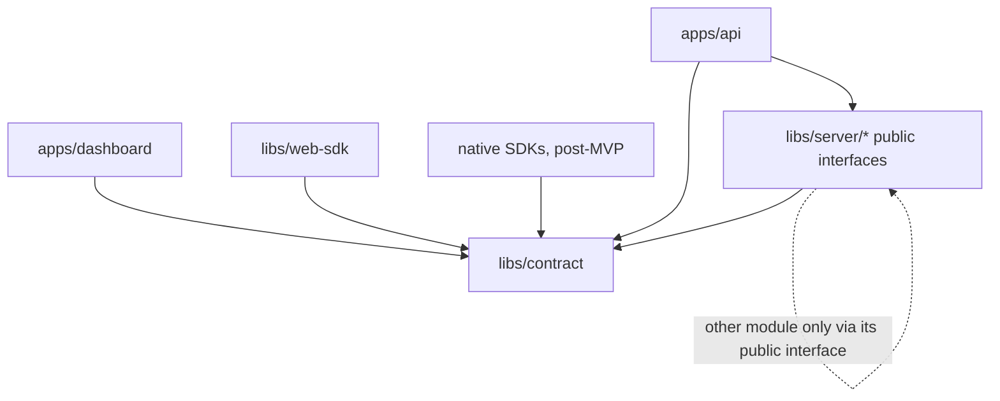
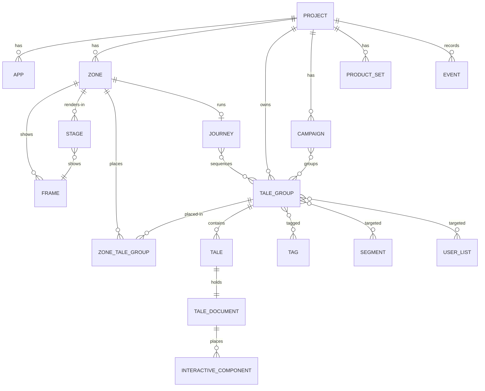

# Architecture Spine — TaleArt

## Design Paradigm

A **modular monolith**: one deployable API process and one PostgreSQL database, split into domain modules that each own their tables and expose a public interface. Edges are ports and adapters: HTTP adapters in `apps/api`, a storage port for media, and the another tool client inside the importer.

| Layer | Lives in |
| --- | --- |
| HTTP adapters (Management API, Delivery API), worker | `apps/api` |
| Domain modules (logic + tables + public interface) | `libs/server/<module>` |
| Shared contract (OpenAPI, generated types, schemas, event names, status map) | `libs/contract` |
| Clients | `apps/dashboard`, `libs/web-sdk`; post-MVP `libs/android-sdk`, `libs/ios-sdk`, `libs/mobile-sdk` |

## Invariants & Rules



Clients never import `libs/server`. Modules never import `apps/*`.

### AD-1 — Modular monolith `[ADOPTED]`

- **Binds:** all
- **Prevents:** an early split into services, and modules reading or writing each other's tables.
- **Rule:** One deployable API and one PostgreSQL database. Each domain module is an Nx lib under `libs/server/` and owns its tables. Another module reaches them only through that module's public interface. Nx module-boundary lint tags enforce the direction in the diagram above.

### AD-2 — Two API surfaces

- **Binds:** R9, R10, FR-002, FR-003, FR-009
- **Prevents:** SDK credentials reaching content writes, and web and native clients using different data paths.
- **Rule:** The Management API (`/api/v1`) serves the dashboard, accepts sessions only, and reads and writes. The Delivery API (`/delivery/v1`) serves every SDK, web and native, accepts zone keys only, reads published content, and writes events. Its zone response lists the tale groups placed in the zone, in that zone's placement order (AD-14), and carries the links to their published media, which are public and need no key (AD-11). No client reads the database or a module directly.

### AD-3 — Contract first `[ADOPTED]`

- **Binds:** dashboard, web-sdk, native SDKs, api
- **Prevents:** request and response shapes drifting between server and clients.
- **Rule:** The OpenAPI 3.1 document in `libs/contract` is the source of truth for both APIs. TypeScript types are generated from it. Native SDKs generate from the same document. A shape change starts in the document.

### AD-4 — Project-scoped shared schema

- **Binds:** R8, FR-001, FR-004, FR-030, AD-14
- **Prevents:** data leaking across projects, and a backfill when usage metering arrives.
- **Rule:** One shared schema. Every content (tale group, tale, zone placement of a tale group), zone, frame, targeting (tag, segment, user list), campaign, product set and event table has `project_id uuid NOT NULL` referencing `projects`. A placement's zone and tale group belong to the same project. A module checks every project it acts on against the caller's credential. It never trusts a `project_id` it has not authorized.

### AD-5 — Frame types are data `[ADOPTED]`

- **Binds:** R10, R11, FR-006, FR-007
- **Prevents:** a migration per frame type, and web and native renderers disagreeing on settings.
- **Rule:** A frame row stores `type` (a registry key) and `settings` (JSONB). Each type has a JSON Schema in `libs/contract`, and the API validates `settings` against it on write. A new type is a registry entry, a schema and a renderer, with no migration. Clients skip frame types they don't know instead of failing.

### AD-6 — Status keys `[ADOPTED]`

- **Binds:** tales, tale groups, importer
- **Prevents:** modules storing different representations of the same status.
- **Rule:** The status keys and their HTTP codes are `draft` 204 `[ASSUMPTION]`, `live` 200, `scheduled` 202, `processing` 102, `invalid-media` 422, `paused` 403, `blocked-by-group` 423, `expired` 410, `quota-reached` 429, `archived` 404, defined once in `libs/contract`. New tale groups and tales start `draft`; rows that existed before `draft` was added migrate to `live`. The key a person or process sets is stored. `scheduled` and `expired` are never stored: they are computed when content is read, from the stored `live` key and the start and end times, so no job moves them. The Delivery API returns only `live` content whose schedule window, and its group's, contains the current time.

### AD-7 — Identity and import links

- **Binds:** R1, R2, FR-026 to FR-029
- **Prevents:** duplicate content on re-import, and another tool ids leaking into the model.
- **Rule:** Every primary key is a UUID generated by the database. Source-system ids live only in the `import_links` table (source system, source type, source id, target type, target id, project id), owned by the importer. Re-running an import updates the linked records instead of creating new ones.

### AD-8 — Importer as a background job `[ADOPTED]`

- **Binds:** R1, R2
- **Prevents:** imports inside HTTP requests, and the importer writing other modules' tables.
- **Rule:** An import is a job row in PostgreSQL, processed by a worker in the same deployable. The importer writes through other modules' public interfaces, checks each another tool record against the live response before mapping it, and stores a report with counts and differences per entity type.

### AD-9 — Credentials `[ADOPTED]`

- **Binds:** FR-002, FR-003, NFR-003
- **Prevents:** credentials stored in plain text, and one credential type working on both surfaces.
- **Rule:** Dashboard users sign in with passkeys (WebAuthn) only; there are no passwords. The first user on an empty install becomes the admin; every later user joins through a one-time invitation an admin creates for a project. After sign-in, sessions are server-side behind an http-only cookie. Zone keys are random secrets, shown once and stored hashed. Rotating issues a new key and revokes the old one.

### AD-10 — Events `[ADOPTED]`

- **Binds:** R7, FR-015, FR-023, FR-025, FR-030
- **Prevents:** metrics that can't be keyed to frames or projects, and metering that needs a backfill.
- **Rule:** SDKs post events to the Delivery API. Each event row records `project_id`, `zone_id`, `frame_id`, `tale_group_id` and `tale_id` where they apply, the event name, and client and server timestamps. Events are append-only, in a table owned by the analytics module. Metrics are computed from events only. Event names are defined in `libs/contract`.

### AD-11 — Media storage port `[ADOPTED]`

- **Binds:** FR-010, FR-012
- **Prevents:** modules writing to disk paths directly, which would block a later move to object storage, and media of unpublished content leaking.
- **Rule:** Media goes through a storage port (put, get and delete by key). The default adapter writes to local disk. Content stores the storage key, never a path or URL. Media of published content is served from public, unguessable URLs that need no key, so an `` or `<video>` loads it directly; the Delivery API returns these URLs with the zone's data. Media of unpublished content is not public: its public URL answers 404 and only the Management API, with a session, serves it. A copied tale group shares its media's storage keys (AD-14): a shared key is public while any published tale references it and is deleted only when nothing references it. The server does not transcode media.

### AD-12 — Names `[ADOPTED]`

- **Binds:** all
- **Prevents:** another tool terms entering the product, and two names for one entity.
- **Rule:** The terminology map binds code, schema and API names. "another tool" appears only inside the importer module, as the source system. Targeting and campaign names approved 2026-10-20: `tags` (on tale groups), `segments`, `userLists`, user attributes (`setUserAttributes`), `externalUserId`, `campaigns` with a schedule (`startsAt`, `endsAt`), `productSets`, and journey (a common noun, never branded). "Audience", "member", "external user key" and "collection" are not entity names.

### AD-13 — No sensitive end-user data

- **Binds:** R5, R7, R9, R12, FR-015, FR-017 to FR-020, FR-023
- **Prevents:** TaleArt becoming a store of the host's end-user data, and targeting that needs that data on the server.
- **Rule:** TaleArt stores no sensitive end-user data. Sensitive user data, such as user attributes (`setUserAttributes`), stays on the client side of the host and is never sent to TaleArt. Targeting that uses user data is evaluated in the SDK on the client: the Delivery API returns the rules and candidate content, and the SDK decides. Events carry content and frame ids, never user attributes. The external user ID is the host's opaque identifier and is not treated as sensitive `[ASSUMPTION]`.

### AD-14 — Tale groups belong to the project; zones place them

- **Binds:** R3, R8, R9, FR-010, AD-2, AD-4, AD-11
- **Prevents:** duplicating a tale group to show it in a second zone, edits that reach only one of the copies, and a zone's order that moves another zone's order.
- **Rule:** A tale group, with its tales, tags, cover and media, belongs to a project. A zone shows an ordered list of placements (`zone_tale_groups`: zone, tale group, position, project), owned by the `tales` module; zones reach them only through its public interface. The same group can be placed in several zones of its project; an edit to the group shows in every zone, and each zone keeps its own order. Removing a group from a zone deletes only that placement; a group placed in no zone still exists in the project. A zone's groups, in the dashboard and the Delivery API, are read through its placements. **Copy to zone** creates an independent tale group, with copies of its tales and tag links and the same media storage keys (files are not duplicated), placed in a zone of the same project or of another project the user can access; the caller must be authorized for both projects (AD-4). In another project, tags are matched by name and created when missing. A storage key referenced by several tales is public while any published tale references it, and its file is deleted only when no tale or cover references it `[ASSUMPTION]` (AD-11). Migration: every existing tale group, from foundation stories 1.3, 1.4 and 1.5 and web-zones story 3.1, becomes a project group with one placement in its current zone, keeping its position.

### AD-15 — Tale document model

- **Binds:** R2, R4, R10, R13, FR-010, FR-012, FR-014, FR-016, FR-032, FR-033, NFR-007, AD-3, AD-5, AD-11
- **Prevents:** tales flattened into images, whose text is not accessible, not editable, not translatable and not sharp; web and native renderers placing elements differently; a migration for each new element type; and markup or style injection through tale content.
- **Rule:** Each tale holds one **tale document**: versioned JSON stored as JSONB on the tale row and owned by the `tales` module. The schema lives in `libs/contract` as JSON Schema (`tale-document/v1.schema.json`), with generated TypeScript types. Its shape is `{ version, canvas, durationMs?, elements[] }`.
  - **Version:** an integer, 1 at launch. Additive changes keep the number: a new optional field, or a new element type. A breaking change raises it, and `libs/contract` ships a forward migration that the server applies when it reads or writes a stored document.
  - **Canvas:** a 9:16 stage. It has a background, either a colour or one media element, and it defines its **safe areas** as contract constants: top 12% (progress bar and close control), bottom 16% (swipe-up and CTA) and 4% on each side `[ASSUMPTION]`.
  - **Elements:** a discriminated union keyed by `type` from an **element-type registry** in `libs/contract`, like frame types (AD-5). The MVP types are `text`, `image`, `video`, `shape`, `sticker` and `button`, plus at most one `swipe-up` per tale. Interactive components (poll, quiz, emoji reaction, countdown, product pins, promo code, Rating) join as further element types, each with its own schema, and the document version stays the same.
  - **Every element has:**
    - `id`: a UUID, unique in the document, used for undo, analytics and later locale variants.
    - `type`.
    - `box`: `{ x, y, w, h, rotation }`. Positions and sizes are fractions (0 to 1) of the canvas width and height, so one document fits every screen and every platform.
    - Size-like properties such as font size and corner radius are fractions of the canvas height.
    - `hidden` and `locked`, which are editor state only.
    - `a11y`: `{ label?, decorative? }`.
    - type-specific `props`.
  - **Z-order:** the order of the `elements` array, first at the bottom.
  - **Reading order:** visual, top to bottom and then left to right by `box` `[ASSUMPTION]`.
  - **Text:** plain Unicode strings, never HTML or Markdown.
  - **Styles:** enumerated or range-checked values, such as a colour as `#RRGGBB` or `#RRGGBBAA` or a font key from the font registry in `libs/contract`. Raw CSS strings are never stored.
  - **Validation on every write:** the Management API checks the document against the schema, with no additional properties, and then applies semantic rules. A refusal uses the standard error body naming the JSON pointer of the field it refused.
    - The document is at most 128 KB, with at most 60 elements and at most 1,000 characters per text `[ASSUMPTION]`.
    - Element ids are unique, and numbers are finite and inside their ranges.
    - Link targets are absolute `http` or `https` URLs of at most 2,048 characters. Any other scheme, `javascript:` included, is refused.
    - Every media reference is a storage key that belongs to the tale's project.
    - An image, a video, an image sticker and an image button need alt text unless `decorative` is set.
  - **Delivery:** the Delivery API returns the document with each published tale, after removing hidden elements and editor-only fields and resolving storage keys to public media URLs. Media is referenced by storage key, never by URL (AD-11), and a key that a published tale's document references counts as referenced and public.
  - **Clients:** they ignore unknown fields and skip element types they do not know, so an older SDK still shows the rest of a tale. Native SDKs render the same document with the same registry (R10).
  - **Migration:** a tale that existed before the document gets a version 1 document with one full-bleed media element for its media.
  - **Later additions:** text locale variants are an additive field keyed by element id, added later.

### AD-16 — SDK document renderer

- **Binds:** R9, R13, NFR-006, NFR-007, AD-2, AD-15
- **Prevents:** tale content running script or style in the host page, the studio preview differing from what visitors see, and the renderer pushing the Web SDK past its budget unnoticed.
- **Rule:** The Web SDK renders a tale document as DOM inside its Shadow DOM.
  - **Stage:** a 9:16 stage sized with container units. Each element is an absolutely positioned node placed from its `box`.
  - **Text:** set only as text nodes (`textContent`), never through `innerHTML`, `insertAdjacentHTML` or a template string.
  - **Styles:** set through CSSOM properties from validated values, never `setAttribute('style', …)`, so the SDK works under a strict host CSP.
  - **Native elements:**
    - Images are ``.
    - Videos are `<video muted playsinline>`.
    - Links are `<a>` elements with `rel="noopener noreferrer"`, and the SDK checks again that the scheme is `http` or `https`.
    - Buttons and links are focusable, with accessible names.
  - **Renderer modules:** one renderer module per element type, keyed by the element-type registry under `libs/web-sdk/src/lib/document/`. An unknown type renders nothing.
  - **Studio preview:** the dashboard's Tale Studio preview mounts the same renderer, imported from `libs/web-sdk`, on the unsaved document, so preview and visitor rendering cannot diverge.
  - **Bundle budget:** the renderer counts toward the 50 KB gzip budget. While the whole SDK stays at or below 40 KB gzipped, it ships as one bundle. When it crosses 40 KB, the viewer, the document renderer and the element renderers move to a chunk loaded on first open, and the entry chunk keeps only what first zone content needs, so the 1.5 s target holds. The size check then reports both chunks `[ASSUMPTION]`.
  - **Fonts:** the SDK loads no font files. Font keys map to system font stacks or to the project theme's `fontFamily`, which the host page loads.

## Consistency Conventions

| Concern | Convention |
| --- | --- |
| Table and column names | `snake_case`; tables plural (`tale_groups`); foreign keys `<entity>_id` |
| JSON fields | `camelCase`; ids are `id` and `<entity>Id` |
| Ids and times | UUIDs; `timestamptz` in the database; ISO 8601 UTC in JSON |
| Errors | `{ "error": { "code": "<machine_code>", "message": "<text>" } }`; `quota-reached` uses its own `code`, distinct from rate limiting |
| API versions | Path prefix `/v1`; a breaking change adds `/v2` |
| Event names | `lower_snake_case`, past tense (`tale_viewed`, `frame_impression`) |
| Migrations | Each module owns its migrations; forward-only; one runner at API start |
| Config | Environment variables only, listed in one `.env.example` |
| Logging | Structured JSON to stdout |
| Tests | Integration tests run against a database whose name ends in `_test` |

## Stack

| Name | Version |
| --- | --- |
| Node.js | 24 LTS `[ADOPTED]` (repo currently runs 22.23) |
| TypeScript | 6.0.3 |
| Express | 4.22.3 |
| Angular | 22.1.8 |
| Nx | 23.3.0 |
| PostgreSQL | 18 `[ADOPTED]` (local container runs 16) |
| node-postgres (`pg`) | 8.23.1 |
| Vitest | 4.1.12 |
| Playwright | 1.64.1 |
| OpenAPI | 3.1 |

## Structural Seed

```mermaid
flowchart LR
  subgraph clients[Clients]
    dash[Dashboard, Angular]
    sdk[Web SDK]
    nat[Native SDKs, post-MVP]
  end
  subgraph host[Self-hosted, Docker Compose]
    api[API process: Management API, Delivery API, worker]
    db[(PostgreSQL)]
    media[(Local media volume)]
  end
  another tool[another tool External API]
  dash -->|session| api
  sdk -->|zone key| api
  nat -->|zone key| api
  api --> db
  api --> media
  api -->|import jobs| another tool
```

Environments: local (Docker Compose), staging (deployed from CI on merge to `main`), and self-hosted installs using the same Compose file.



A tale group belongs to its project, not to a zone. `ZONE_TALE_GROUP` (table `zone_tale_groups`: zone, tale group, position, project) places a group in a zone; a zone shows its placed groups in its own order, and the same group can be placed in several zones of its project (AD-14). Every frame in a zone shows all of the published tale groups placed in the zone; a frame does not pick groups. A zone has several stages, each showing one of its frames. A playbook is not a table: it is registry data in `libs/contract`, like the frame-type registry, and the zone records the key of the playbook applied to it. The theme is set per project (validated by a theme schema in `libs/contract`); the Web SDK configuration may override it per zone. A user list holds external user IDs (no separate member entity). User attributes are passed by the SDK at runtime, not stored as an entity. A tale's document (AD-15) is a JSONB column on the tale, not a table; interactive components are element types placed in it, and their responses live in the `interactive` module. CAMPAIGN and JOURNEY are post-MVP. PRODUCT_SET comes later, after product feeds exist.

```text
apps/
  api/            # HTTP adapters, worker, module wiring
  dashboard/      # Angular, Management API client
  docs/           # published docs, including metric definitions
libs/
  contract/       # OpenAPI 3.1, generated types, frame and theme schemas, playbook registry, tale document schema and element-type and font registries, event names, status map
  server/
    access/       # projects, users, sessions, zone keys
    zones/        # zones, frames, stages, applied playbook key, journeys (post-MVP); registries live in contract
    tales/        # tale groups (owned by the project), zone placements of tale groups (zone, group, position), tales and their tale documents (AD-15), schedules, status, copy to zone
    interactive/  # interactive components and responses
    targeting/    # tags, segments, user lists, user attributes, external user IDs
    campaigns/    # campaigns and their schedules (post-MVP)
    product-sets/ # product sets, product feeds (later, after product feeds)
    analytics/    # events, metrics
    importer/     # another tool import jobs, import links, reports
    storage/      # media storage port and local adapter
  web-sdk/        # Delivery API client, frame renderers and the tale document renderer (AD-16), also used by the Tale Studio preview
```

## Quality Targets

| Target | Value |
| --- | --- |
| NFR-006 — Web SDK first zone content visible | ≤ 1.5 s at p75, mid-tier mobile, Fast 4G `[ADOPTED]` |
| NFR-006 — Web SDK bundle | ≤ 50 KB gzipped `[ADOPTED]` |
| NFR-006 — Delivery API reads | p95 ≤ 300 ms at 50 requests/s on a 2 vCPU, 4 GB host `[ADOPTED]` |
| NFR-006 — Management API | p95 ≤ 500 ms at the same load `[ADOPTED]` |
| NFR-006 — another tool import | 1,000 tales within 30 minutes `[ADOPTED]` |
| NFR-007 — Accessibility | WCAG 2.2 level AA, dashboard and Web SDK UI `[ADOPTED]` |

## Capability → Architecture Map

| Capability | Lives in | Governed by |
| --- | --- | --- |
| R1, R2 another tool import | `libs/server/importer`, worker | AD-7, AD-8, AD-12 |
| R3 foundation entities | `access`, `zones`, `tales` (product sets moved out of the foundation to `product-sets`, later) | AD-1, AD-4, AD-14 |
| R4 interactive components | `libs/server/interactive`, `libs/web-sdk`; each component is an element type in the tale document | AD-3, AD-10, AD-15 |
| R5, R12 targeting | `libs/server/targeting`, rules evaluated in `libs/web-sdk` | AD-2, AD-4, AD-13 |
| R6 scheduling | `libs/server/tales`, computed when read | AD-6 |
| R7 analytics | `libs/server/analytics` | AD-10, AD-13 |
| R8 project tag | every module | AD-4 |
| R9 Web zones | `libs/web-sdk`, Delivery API, public media URLs | AD-2, AD-3, AD-11 |
| R10 native-ready, extensible | `libs/contract`, frame registry | AD-3, AD-5 |
| R11 stage and playbook | `libs/server/zones`, playbook registry in `libs/contract` | AD-5 |
| R13 Tale Studio | `apps/dashboard` (Tale Studio), `libs/server/tales` (tale document), `libs/contract` (document schema, element-type and font registries), `libs/web-sdk` (document renderer) | AD-11, AD-15, AD-16 |
| NFR-006, NFR-007 | all clients and APIs | Quality Targets |

## Deferred

- **Analytics queue:** direct writes until load shows a need (AD-10).
- **Object storage adapter:** the storage port allows it later (AD-11).
- **External identity provider (OIDC):** built-in sessions first.
- **Native SDK internals and offline caching:** post-MVP; bound only by AD-2, AD-3 and AD-5.
- **Usage metering and audit export (FR-030):** post-MVP; AD-4 and AD-10 keep the data ready.
- **Caching and CDN for the Delivery API:** after performance is measured against the targets.
- **Horizontal scaling and worker locking:** single instance until needed.
- **Staging host provider:** chosen when the staging story starts; the user provides it.
- **Backups and restore:** documented with the self-hosting guide, before the first release.
- **Conversion tracking:** TaleArt's own design, post-MVP.
- **Campaigns (FR-031):** post-MVP, in a separate `campaigns` module rather than `tales`, so tale groups stay free of campaign logic; a campaign references tale groups through the `tales` public interface and is a reporting unit for `analytics`. A tale group in a campaign is delivered only inside both its own window and the campaign's schedule.
- **Journeys:** post-MVP, in `zones` (a zone holds a frame or a journey); distinct from playbooks.
- **Product sets (FR-021, FR-022):** after product feeds exist, in `product-sets`; out of the foundation epic (user, 2026-10-20).
- **Tale Studio beyond the MVP:** templates gallery, a brand kit beyond the project theme, uploaded font files, animations, GIF search, AI assist, text locale variants, a reading-order override and collaborative editing. AD-15 keeps each of them additive: a new element type, a new optional field or a new registry entry.
- **Native document renderers:** post-MVP; they render the AD-15 document with the same element-type registry.
