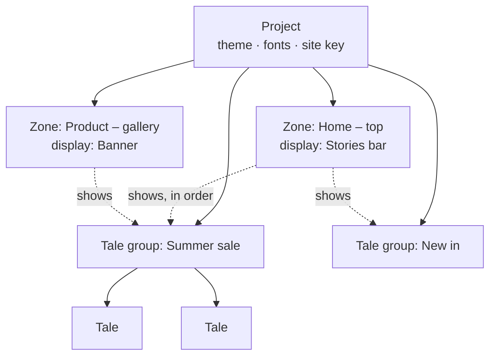
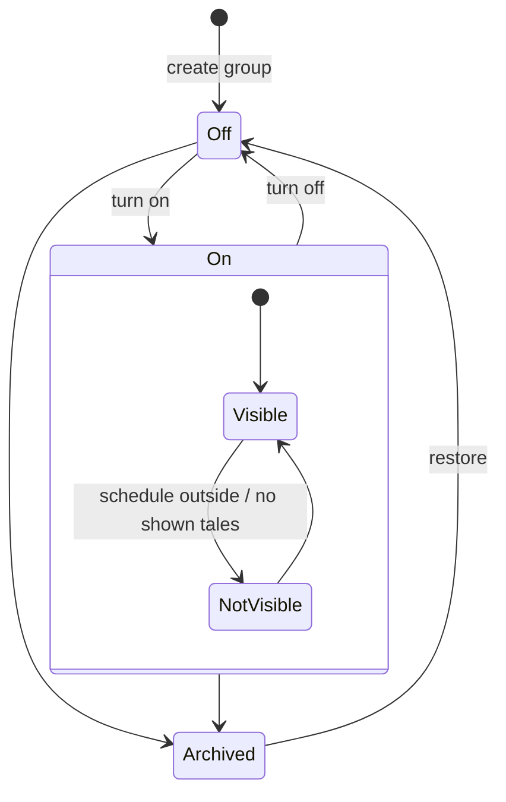

# UX review: dashboard first-run journey and concept model

Date: 2026-10-23 · Branch `autopilot/foundation` (59de6c0) · Reviewer: UX (agent)
Method: I read the PRD, the architecture (AD-2, AD-6, AD-14, AD-15), the web-zones and Tale Studio epics, the terminology map, the competitor digests and the dashboard code. Then I walked the built app as a new user on a throwaway database (API, dashboard and SDK sample page on spare ports) using Playwright, with a virtual passkey. Screenshots are in this folder, at 1440×900 (desktop) and 390×844 (files `40-45`, mobile).

---

## 1. Executive summary

1. **"Live" doesn't mean "visible".** A group can show a green **Live** badge while the site shows nothing, for example when its tales are still Draft or Scheduled. Nothing on screen says why (`18` vs `19`, `36` vs `37`). This is the most damaging problem.
2. **Every tale has to be published by hand, one at a time.** Tales start as Draft. Publishing the group doesn't include them. Each tale takes 3 clicks (open drawer, Publish, close). There's no bulk action and no "publish all" (`20`, `21`). This is owner note 2.
3. **"Publish" means two different things.** The group/tale **Publish** button means "make visible". Tale Studio's **Publish changes** means "copy the draft document to the published document". After Publish changes, the Studio says "Published — up to date. The tale is not live, so visitors do not see it yet" (`35`).
4. **Schedules are always in view, even when nobody uses them.** Each group row has a Schedule button and a "No schedule" line. Each tale drawer has a "No schedule" line and a Schedule… button. The schedule drawer shows "Remove schedule" when no schedule exists (`18`, `20`, `24`). This is owner note 1. Schedules aren't actually required, but the UI makes them look like an expected step.
5. **The tale-group row is overloaded.** A group row has up to 10 buttons at the same visual weight (Publish/Pause, Archive, Tags, Rename, Schedule, Cover, Add to zone…, Copy to zone…, Remove from this zone), plus reorder controls. On a phone the group name wraps one letter per line (`42`). There's no compact way to scan status across groups. This is owner note 3.
6. **Zone, frame, stage and playbook don't match how people think.** The owner thinks of a zone as a piece of real estate. In the product, a *stage* is the real estate, while a *zone* is a bundle of frames, stages, a key and tale groups. Applying the playbook called "Home page stories bar" to a zone named "Product page" is allowed and looks odd (`30`, `31`). This is owner note 4.
7. **There's no guided first run.** The zone page shows five equal cards (Playbook, Frames, Stages, Zone key, Tale groups) with no order and no "you're 3 of 5 steps from going live". The content people care about (tale groups) is last (`08`). It takes about 35 actions to get two tales visible, plus pasting the key into the page.
8. **Zone lists and the Tale groups page show no visibility status.** Zone cards show the frame type and a count only (`32`). The Tale groups page has no filter and no status column (`27`).

**Most valuable fix:** one computed "Visible on site / Not visible because…" indicator on every zone, group and tale, combined with tales that are on by default. Together they resolve notes 1 and 2 and most of item 1.

---

## 2. The owner's four notes

### Note 1: "I wouldn't require a schedule if none was set"

**What happens today**
- Schedules are optional in the data model. A missing start or end means the window is open (AD-6, schedule story). Content without a schedule is live as soon as it's published.
- The UI still shows schedules everywhere:
  - every group row has a **Schedule** button and a grey **"No schedule"** line (`18`, `23`);
  - every tale drawer has "No schedule" and **Schedule…** next to the status (`20`);
  - the schedule drawer offers **"Remove schedule"** when there's nothing to remove (`24`).
- When a schedule *is* set, the tale card shows **Scheduled**. The group still shows **Live**, and the site shows nothing (`36`, `37`). So people learn that schedules can hide content without telling them.

**Why it confuses.** When a field is always visible and stated in the negative ("No schedule"), it looks like a missing step (Nielsen #8 and #6). It sits right next to the status buttons, so it reads as part of publishing.

**Options**

| Option | Pros | Cons |
|---|---|---|
| A. Hide schedule until used: "Schedule" moves into the ⋯ menu. A chip ("Starts 1 Dec") appears only when a window exists. | Least noise; matches how often people actually use it | Slightly less discoverable |
| B. Keep the button and drop the "No schedule" text | Very small change | Still 1 of 10 buttons on the row |
| C. Fold the schedule into the visibility control: "On · Off · On between…" | One place for "when is this visible" | Bigger change to the component |

**Recommendation: A now, C later.** Never print "No schedule". Show "Remove schedule" only when a window exists. When a window hides content, say so in the visibility indicator: "Not visible: starts 1 Dec 09:00".

### Note 2: "Turning a group on should turn everything on, with per-tale opt-out"

**What happens today (AD-6)**
- New groups **and** new tales start as `draft`.
- Content is delivered only when the group is `live` **and** the tale is `live` **and** both schedule windows contain now. A live group with no live tales is dropped.
- **Blocked by group** appears only when a live tale sits in a *paused* group (`25`). If the group is *draft*, its live tales still read "Live", and nothing explains why they don't show.
- Tale Studio has its own draft and published documents. Setting a tale live also publishes its draft the first time (AD-15).
- **What a user does today to make one group with N tales visible:** Publish the group (1 click), then for each tale open its drawer, click Publish and close it (3N clicks). The zone also needs a frame and a key, and the page needs the snippet.
- The owner's statement "it just turns on all the tales" isn't what the build does. The build turns on **none** of them (`18` → `19`). Either way, the owner expects a group switch with per-tale exceptions, and today there's neither.

**Why it confuses.** People think of the group as the thing they publish, and of tales as its pages. Asking for a second, per-item publish step with no bulk action (#7) and no explanation (#1) breaks that expectation.

**Options**

| Option | Pros | Cons |
|---|---|---|
| A. **Tales are "on" by default.** The group switch controls visibility. Each tale has a "Hide from group" toggle. | Matches the owner's mental model: one action to go live, opt-out per tale | Changes the AD-6 default; a half-made tale shows unless hidden (mitigate: Studio drafts stay private until "Update", see §4) |
| B. Keep tale drafts, and when a group is published ask "Also publish its 2 draft tales? [Publish all] [Only group]" | Small change; keeps the safety net | Still two concepts; the dialog appears on every publish |
| C. Bulk select on tales plus "Publish selected" | Flexible | Doesn't fix the default; more UI |

**Recommendation: A.** Tale states become **Shown** (default) or **Hidden**, plus Archived. Group states become **On** or **Off**, plus Archived. Draft and Paused merge into Off in the UI. Keep `processing` and `invalid-media` as computed warnings. Keep `scheduled` and `expired` as computed reasons. This is a product decision (D2, D3).

### Note 3: "The group row is overloaded; use a ⋯ menu, cards or a list"

**What happens today.** Each group row is a header with the cover, name, status, "2 / 100", "No schedule", "Also in", up to 10 outlined buttons and move arrows, followed by a full horizontal strip of tale cards (`18`). On a phone the actions take most of the width and the name wraps letter by letter (`42`, `43`). You can't see the status of several groups at once without scrolling past each group's tales.

**Options**

| Option | Pros | Cons |
|---|---|---|
| A. **List (table) view**: one compact row per group with status columns and a ⋯ menu; click a row to open the group | Fastest to scan; handles 50+ groups; reorder fits naturally; works on phone as stacked rows | Tale thumbnails move one click away |
| B. Card grid that mirrors the bar (cover, name, status chip, ⋯) | Visual and close to what visitors see | Harder to show several status facts; reordering a grid is clumsier |
| C. Keep rows, add a ⋯ menu and collapse the tale strip | Smallest change | Still long; status not in a column |

**Recommendation: A**, with an optional grid toggle later. See the wireframe in §5.

### Note 4: "Zone, stage and frame are unclear; I thought a zone is real estate"

**What happens today**
- **Zone** = a container that holds frames, stages, one key, an optional playbook and an ordered list of tale groups.
- **Frame** = a display style (Bar or Banner) with settings. A zone can have several.
- **Stage** = a named spot on a page (`<taleart-view stage="key">`) that shows *one* of the zone's frames. Without a stage, the page shows all the zone's frames stacked.
- **Playbook** = a one-time preset that creates a frame and a stage.
- So the real estate is the **stage**, and the zone is closer to a **channel** (one content list, one key). Two spots on the same page show the same tale groups unless you create two zones, each with its own key.
- The research terminology map defines a zone as "a location in an app that holds one Frame" (one frame per zone). The PRD and the build allow many. The owner's intuition matches the terminology map, not the build.

**Recommendation.** See §3: a zone is one spot, with one display style. Stage is folded into zone. Playbook becomes a template you pick when you create a zone.

---

## 3. Concept model proposal

### Evaluation

| Model | Zone means | Frame | Stage | Verdict |
|---|---|---|---|---|
| Today | Content channel + key + several frames | Several per zone | Spot on page showing one frame | 3 nouns for 1 idea ("put stories here"); real estate is hidden in "stage" |
| **Proposed (fold)** | **A spot in your app or site** (page area) | **Its display style**, one per zone (a setting, not a list) | **Removed**: each stage becomes its own zone | 1 noun = 1 thing people point at; matches the owner's model and the competitor's placement |
| Rename only | Keep 3, rename stage → "Placement" | – | – | Cheaper, but keeps the two-level indirection |

### Proposed definitions (glossary)

| Term | Definition (one line) | Example |
|---|---|---|
| **Project** | Your app or site. Holds everything below, plus the theme and fonts. | "Acme Shop" |
| **Zone** | One spot in your app or site where tales appear. A page can have several zones, and a zone can appear on several pages. | "Home – top", "Product – under gallery" |
| **Display** (was *frame*) | How a zone looks: Stories bar or Banner, plus its settings. Exactly one per zone. You can change it at any time. | Bar, circles, medium |
| **Template** (was *playbook*) | A starting preset you pick when creating a zone (display plus settings). Not stored as a separate thing. | "Stories bar", "Promo banner" |
| **Tale group** | A set of tales shown as one item (one circle or one banner slide). Can be shown in several zones. | "Summer sale" |
| **Tale** | One full-screen page of a group: media plus layers, made in Tale Studio. | "Opening" |
| **Theme** | Colours, rings and fonts for every zone in the project. | – |

Keep "frame" as the internal and API name if renaming costs too much, but say **Display** or **Style** in the UI.



### Impact

- **SDK:** today `<taleart-view>` + `configureZone(zoneKey)` + optional `stage="key"`. Proposed: `<taleart-view zone="home-top">` with one project or site key in config, or keep a per-zone key, see D1. Keep backward compatibility: an old zone key plus `stage` attribute resolves to the migrated zone. A zone key with no `stage` resolves to the first migrated zone.
- **Data model:** `stages` merge into `zones` (zone gains `key` slug and one `frame`). `zone_tale_groups` (AD-14) already lets several zones share groups. Nothing changes for content.
- **Migration:** for each stage, create a zone (name = stage name, slug = stage key, display = that stage's frame) and copy the parent zone's placements in the same order. Zones with frames but no stages: one zone per frame, with the first one keeping the original id. `playbook_key` becomes a "created from template" note only.
- **Delivery API (AD-2):** a response describes one zone with one display. That's simpler for the SDK.

---

## 4. Status and publishing model proposal

**Principle:** one switch for "on the site", and one computed sentence that says why something is or isn't visible.

| Level | Person sets | Default | Computed reason (shown, never set) |
|---|---|---|---|
| Group | **On / Off**, plus Archive (in ⋯) | Off | Scheduled, Ended, No shown tales, Not in any zone |
| Tale | **Shown / Hidden**, plus Archive | **Shown** | Processing, Media problem, Scheduled, Ended, Group off |
| Schedule | Optional "Only between…" (⋯ → Schedule) | None, and nothing printed | Feeds the reasons above |

**Visibility indicator** (on zone cards, group rows and tale cards):
- ● **Visible on site**
- ○ **Not visible:** *group is off* · *no shown tales* · *starts 1 Dec 09:00* · *ended 3 Nov* · *zone has no display* · *zone not installed yet (no key)* · *media still processing*

**Tale Studio "Publish changes."** Rename it to **"Update tale"** when the tale is visible ("3 unsaved-to-site changes · Update tale"). Rename it to **"Save as ready"**, or hide it, when the tale isn't visible yet. When the group is turned On, it uses each tale's latest *updated* version. Show the status line in the same words as the indicator: "Visible on site · draft has changes" or "Not visible: group is off". Never use the word "Publish" in two places.



API mapping: keep the stored keys. On = `live`. Off = `draft` or `paused`, merged in the UI. Shown = `live`. Hidden = `paused`. New tales are stored `live`. Apply `blocked-by-group` when the group is draft **or** paused, not only paused.

---

## 5. Information architecture and layout

### Zone page: from five equal cards to one task

```
┌ Home – top ─────────────────────── ● Visible on site   [⋯] ┐
│ Stories bar · 3 groups · Installed (key issued)             │
│ [Tale groups]  [Display]  [Install]                          │  ← tabs; Tale groups is default
├──────────────────────────────────────────────────────────────┤
│ Setup ▸ ✓ Display  ✓ Key  ○ A tale group with a shown tale   │  ← only until first visible
├──────────────────────────────────────────────────────────────┤
│ ⠿ ◯ Summer sale   ● Visible   3 of 4 shown   [On ●]   [⋯]    │
│ ⠿ ◯ New in        ○ Off       5 shown        [Off ○]  [⋯]    │
│ ⠿ ◯ Black Friday  ○ Starts 1 Dec  2 shown    [On ●]   [⋯]    │
│ [+ New tale group]   [+ Add existing group]                  │
└──────────────────────────────────────────────────────────────┘
⋯ = Rename · Cover · Tags · Schedule · Show in another zone · Duplicate to zone · Remove from this zone · Archive
```

- Primary action per row: **the On/Off switch**. Everything else goes in the ⋯ menu.
- Clicking a row opens the **group page** (or a wide drawer): tale strip, Add tale, per-tale Shown/Hidden toggle, tale ⋯ (Edit in Studio, Replace media, Schedule, Archive).
- **Display** tab = today's frame settings plus a live preview. **Install** tab = the key, a copy-paste snippet with the zone attribute already filled in, and "Open test page".

### Phone (390 px)

```
┌───────────────────────────┐
│ ◯ Summer sale       [On●] │
│   ● Visible · 3 of 4  [⋯] │
├───────────────────────────┤
│ ◯ New in           [Off○] │
│   ○ Off · 5 shown     [⋯] │
└───────────────────────────┘
```

### Zones list
Show each zone as a row or card with its visibility dot, display type, group count and "Installed / Not installed". **Tale groups page**: the same list component, plus filters (Visible, Off, Scheduled, Not in a zone) and the "New tale group" button that's missing there today.

---

## 6. Heuristic evaluation (other issues found)

| # | Issue | Heuristic | Sev | Where | Shot | Fix |
|---|---|---|---|---|---|---|
| 1 | Group reads **Live** while the site shows nothing (draft or scheduled tales) | #1 Visibility | High | Zone › group | `18` `19` `36` `37` | Visibility indicator (§4) |
| 2 | Tales in a *draft* group read "Draft" or "Live" with no reason; "Blocked by group" is only for paused groups | #1 / #4 | High | Tale card, drawer | `25` | Apply blocked to draft too; plain words |
| 3 | No bulk publish; 3 clicks per tale | #7 Efficiency | High | Tale drawer | `20` | Tales on by default; toggle on card |
| 4 | "Publish" vs "Publish changes"; Studio says "Published… not live" | #4 Consistency | High | Tale Studio | `35` | Rename (§4) |
| 5 | Mobile group row: name wraps per letter, "2 / 10…" cut, 10 buttons | #8 Minimalism | High | Zone, 390 px | `42` `43` | List row + ⋯ (§5) |
| 6 | No first-run guidance; five equal cards; tale groups last | #6 Recognition | Med | Zone page | `08` | Tabs + setup checklist |
| 7 | "No schedule" everywhere; "Remove schedule" with no schedule | #8 | Med | Row, drawer | `18` `24` | Hide until used |
| 8 | Tale drawer footer is **Cancel / Upload**, but status changes save instantly; Cancel undoes nothing | #4 / #5 | Med | Tale drawer | `20` `21` | Split: status at top saves; "Replace media" as its own action; footer "Done" |
| 9 | Zone cards show no visibility or install state | #1 | Med | Zones | `32` | Dot + "Installed" |
| 10 | Key shown once with no ready snippet or test link; the user must know the `<taleart-view>` markup | #10 Help | Med | Zone key | `12` | Install tab with snippet + "Open test page" |
| 11 | Playbook "Home page stories bar" applied to a "Product page" zone; once applied the card is a dead end | #2 Match | Med | Zone › Playbook | `30` `31` | Template picked in New zone; then gone |
| 12 | Tale groups page: no create button, no filter, only "Copy to zone…" | #7 | Med | /tale-groups | `27` | Shared list component + filters |
| 13 | "In every zone" grey text where a button would be; reads like a status | #2 | Low | Group actions | `18` `27` | Remove; disable the menu item with a tooltip |
| 14 | Live tales have no badge; only non-live ones do (state shown by absence) | #6 | Low | Tale card | `23` | Always show a small dot |
| 15 | Frames named "Frame 1 · Bar"; can't name them | #6 | Low | Stages | `11` | Gone with §3; until then allow names |
| 16 | New zone drawer asks for a project even when there is one | #7 | Low | New zone | `06` | Preselect and hide when there's one |
| 17 | API error banner says "Is it running on port 3333?" (developer text) | #9 Errors | Low | Shell | code `app.html` | "We can't reach TaleArt. Retrying…" |
| 18 | Studio keyboard help paragraph always open; "Back" target unclear | #8 | Low | Tale Studio | `33` | Collapse into a "?" popover; "Back to Summer sale" |
| 19 | Theme lives under Projects and can't be found from a zone | #6 | Low | Projects | `28` `29` | Link "Style: project theme" in the Display tab |

**First-run cost measured:** sign-up (3 actions), project (3), zone (3), open zone (1), frame (3), key (4), group (3), 2 tales with media (8), publish group (1), publish 2 tales (6). That's **35 actions** before anything shows, and no step tells you what's still missing. Target after fixes: about 15 (template creates the display; key on the Install tab; tales on by default; group On).

---

## 7. Prioritised fix list (small stories)

| # | Story | Size | Needs decision |
|---|---|---|---|
| 1 | Visibility indicator ("Visible / Not visible because…") on tale, group and zone, computed from AD-6 + windows + zone setup | M | – |
| 2 | Hide schedule until used: drop "No schedule", move Schedule into the ⋯ menu, chip only when set, "Remove schedule" only when set | S | – |
| 3 | Group row → list row: On/Off switch + ⋯ menu; tale strip moves to a group page or drawer | M | D5 |
| 4 | Mobile fixes for the group row (name wrap, overflow) | S | – (folded into 3 if done together) |
| 5 | Tales on by default + per-tale Shown/Hidden toggle on the card; `blocked-by-group` for draft groups too | M | **D2, D3** |
| 6 | Rename Studio "Publish changes" and align its status line with the indicator | S | **D4** |
| 7 | Zone page tabs (Tale groups / Display / Install) + first-run setup checklist | M | – |
| 8 | Install tab: snippet with the zone filled in, copy button, "Open test page" | S | – |
| 9 | Tale drawer: status saves instantly, footer "Done", "Replace media" as its own action | S | – |
| 10 | Zones list and Tale groups page: status dot, filters, New tale group button | S | – |
| 11 | Fold stage into zone; display = one per zone; template at zone creation; SDK `zone=` with backward compatibility; migration | L | **D1, D6, D7** |
| 12 | Copy and polish: "In every zone", API banner text, preselected project, Studio help popover | S | – |

Suggested order: 2 → 1 → 3/4 → 9 → 5 (after D2/D3) → 6 → 7/8 → 10 → 11 (after D1).

### Decisions for the owner (each with a recommendation)

- **D1. Should a zone be one spot with one display style, with stages folded into zones?** *Recommend: yes.* It matches the owner's mental model, the terminology map ("holds one Frame") and the competitor's placement. It's the largest change (story 11).
- **D2. Should new tales be visible by default when their group is on, with per-tale "Hide"?** *Recommend: yes.* Studio edits stay private until "Update tale", so half-finished work doesn't leak.
- **D3. Should the UI merge Draft and Paused into a single "Off" for groups and tales?** *Recommend: yes.* Keep the stored keys. Show Archive only in the ⋯ menu.
- **D4. Should the Studio button become "Update tale", with "Publish" reserved for visibility?** *Recommend: yes.* (Alternative: autosave straight to the site, which isn't recommended because there's no review step.)
- **D5. Should the zone page default to a list or to cards?** *Recommend: list,* with a grid toggle later.
- **D6. Should the SDK use one key per zone or one site key plus a zone name?** *Recommend: a site key per project, plus `zone="home-top"`.* Each page needs one key, and zones become cheap to add. Old zone keys keep working.
- **D7. Should playbooks become templates chosen in "New zone", with no lasting Playbook card?** *Recommend: yes.*

---

### Screenshot index
`01–07` sign-up → project → zone · `08` empty zone page · `09–13` frame, settings, stage, key, group drawers · `15` add tale · `17` site, all draft · `18` group Live, tales Draft · `19` site empty · `20–21` tale drawer before and after Publish · `22` site shows the group · `23` zone with one live tale · `24` schedule drawer · `25` paused group → Blocked by group · `26` stage on site · `27` Tale groups page · `28–29` projects, theme · `30–31` playbook · `32` zones list · `33–35` Tale Studio and Publish changes · `36–37` scheduled tale: group Live, site empty · `40–45` mobile.
