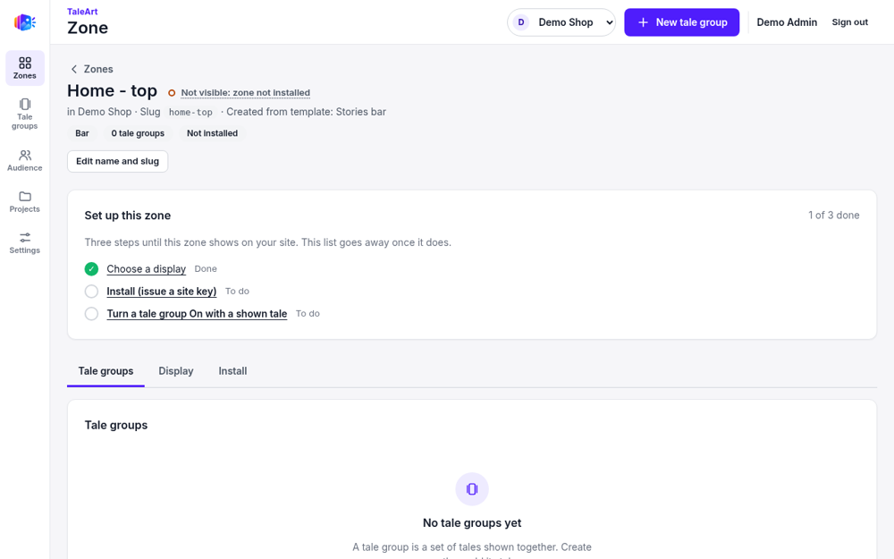
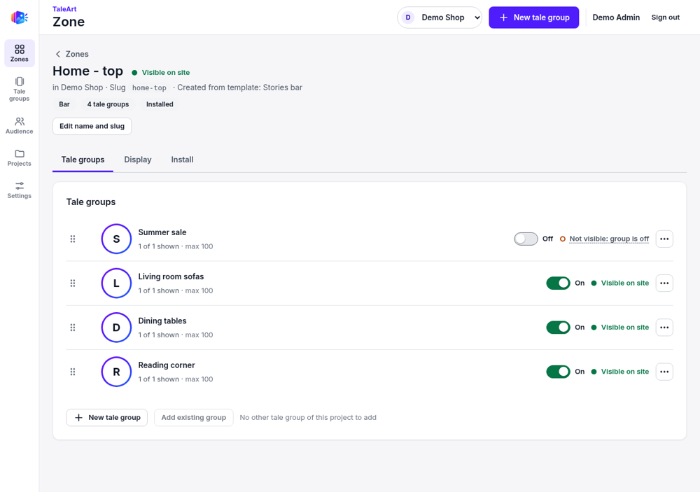
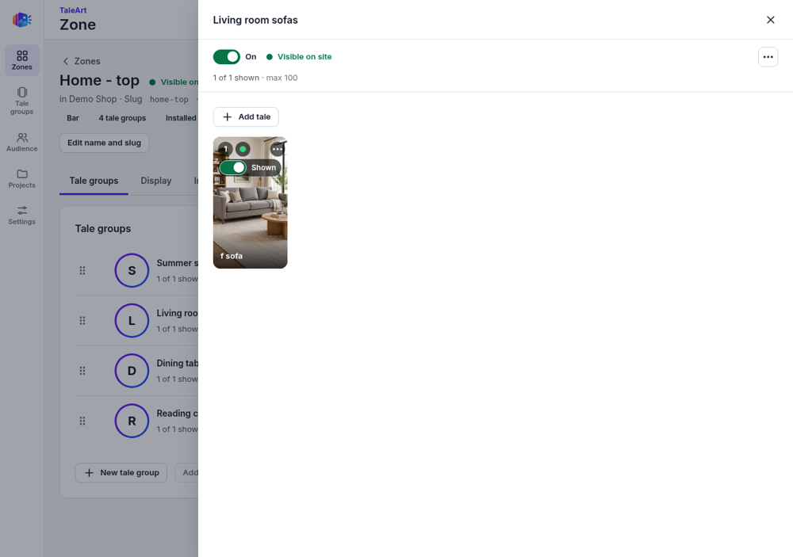
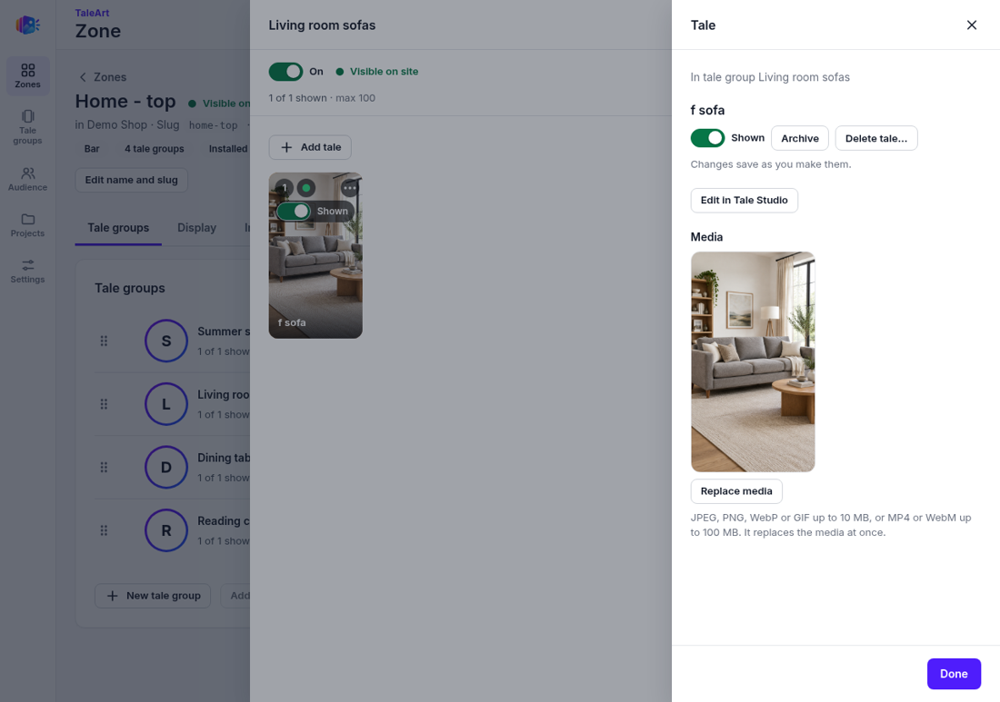
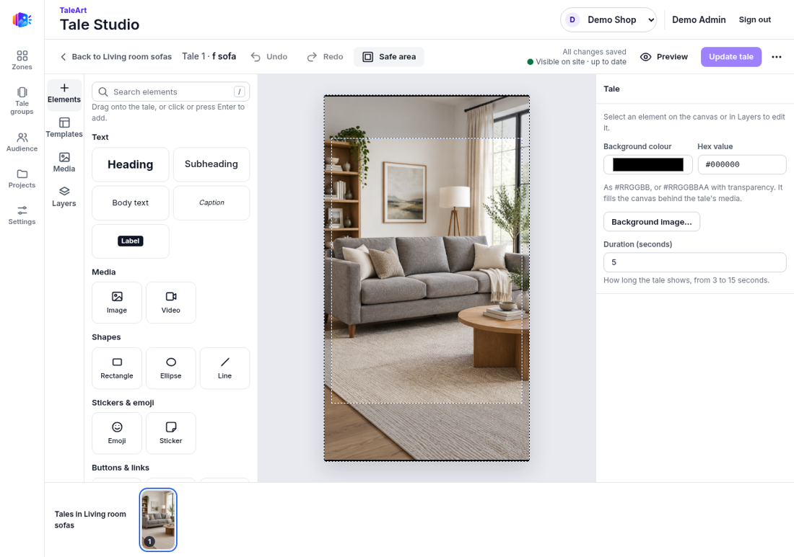
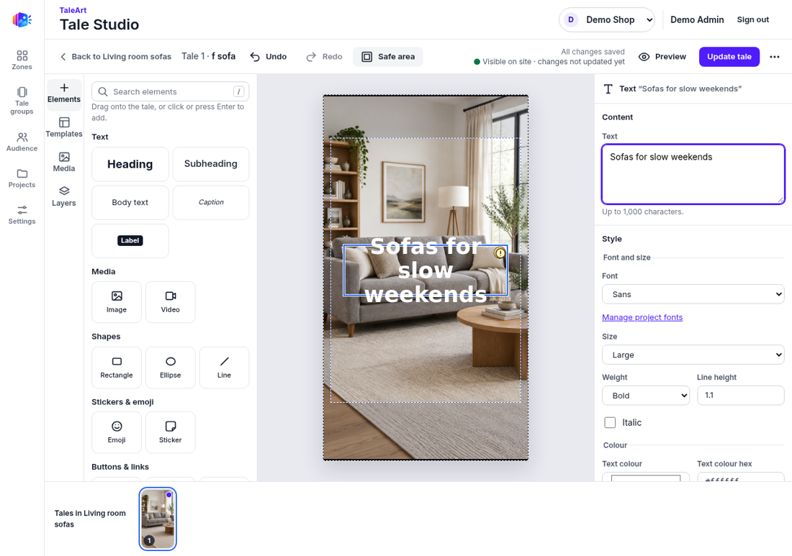
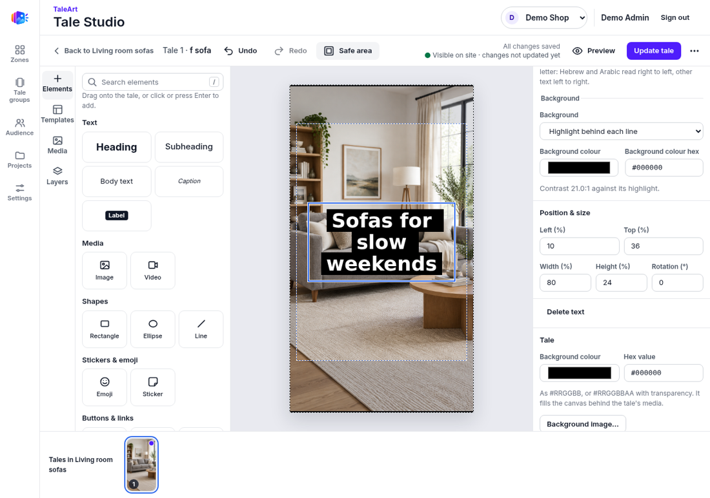
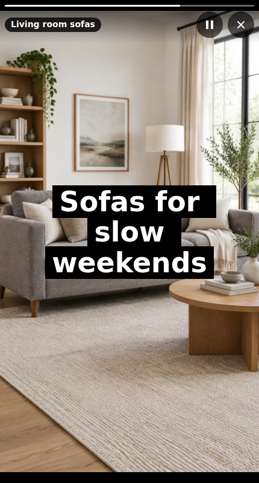
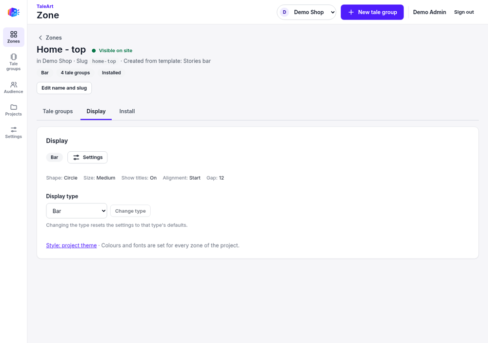

# 2. Create a marketing campaign

A campaign is a **zone** (a spot on your site) that shows **tale groups** (one circle in a bar), each made of **tales** (full-screen pages of image, video and text). See the docs site, Concepts page, for the glossary.

## Create the zone
1. Zones, then **New zone**.
2. Name it (example: "Home - top"). The slug (`home-top`) is made from the name if left empty. Pick a template: Stories bar, Promo banner or Blank.

The page shows why a zone is not visible yet, and a checklist: choose a display, issue a site key, turn a tale group On with a shown tale.

## Add tale groups
1. **New tale group**, give it a name, and upload an image or video: each file becomes a tale. New tales are Shown.
2. Turn the group **On**. New groups start Off.

In the furniture example we made three groups: Living room sofas, Dining tables and Reading corner, each with one generated sample illustration.

Open a group to see its tales. Each uploaded file is one tale, shown by default, with an **Add tale** button.

Click a tale to open its panel: Shown/Hidden, Archive, Delete, Replace media, and **Edit in Tale Studio**.

Tale Studio opens the tale on a canvas with an Elements palette (text, image, video, shapes, emoji, stickers, buttons, polls and more), Templates, Media and Layers, a Safe area toggle, Undo/Redo, Preview, and **Update tale**, which puts your changes on the site (until then visitors see the previous version).

### Add a heading and publish the change
1. In the Elements palette, click **Heading**. It lands on the canvas. Change the text in the **Text** box on the right (up to 1,000 characters).
2. Studio saves as you work ("All changes saved") but visitors still see the old version: the status says "changes not updated yet".
3. Click **Update tale**. Studio confirms "Tale updated. Visitors now see this version."

Studio warns about low contrast here (white text on a light photo, about 1.4:1). Fix it in the text's style panel: set **Background** to **Highlight behind each line** (or **Solid box**) and pick a dark colour. The panel then reports the contrast against the highlight (21.0:1 for black). Also make the text box tall enough for the text (we set Top 36%, Height 24%), then click **Update tale** again.

The fixed heading shows in the viewer on the example website:

Only the Heading element was tested. Other elements (images, shapes, buttons, polls, Templates, Media, Layers) were not exercised.

A group, and each tale, can also be scheduled (the ... menu) so it only shows in a time window.

## Check visibility
Every zone, group and tale says "Visible on site" or "Not visible" with the first reason. The Display tab sets bar or banner options.

