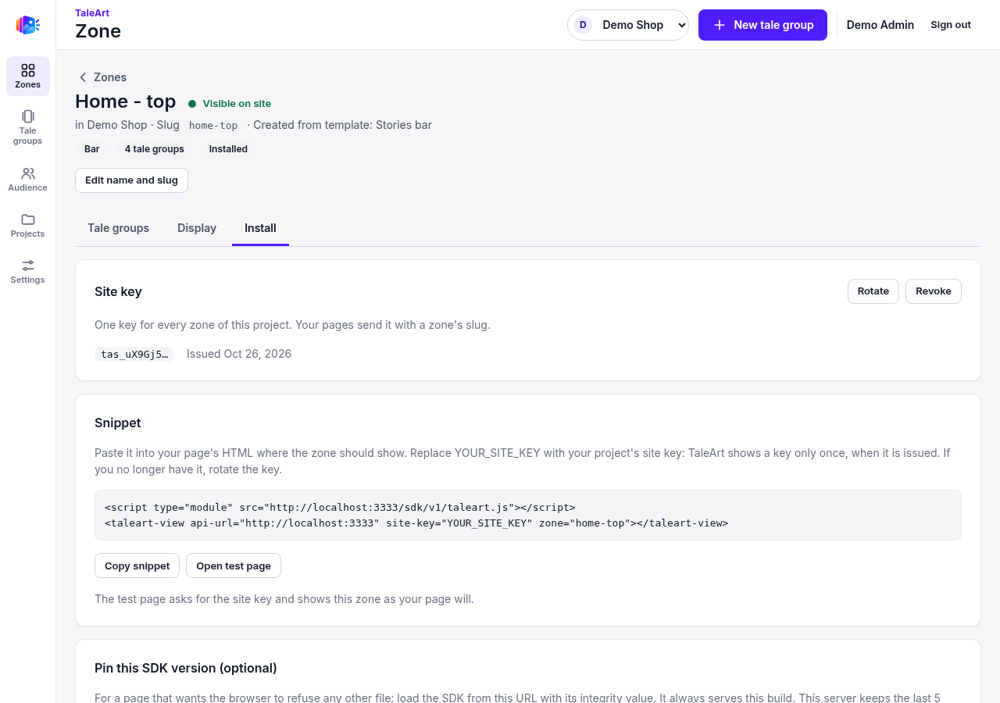
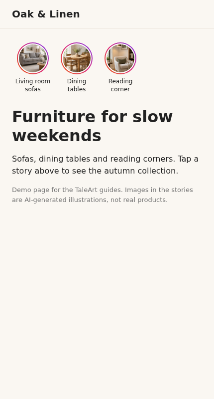
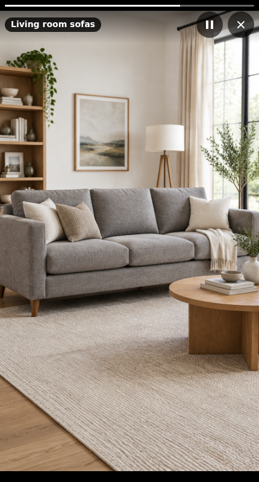

# 3. Connect the campaign to a website

## Issue the site key
Open the zone, then the **Install** tab, then **Issue site key**. The key (`tas_...`) is shown once. It opens every zone of the project that has a display and visible content, by slug, and sits in page HTML, so it is not a secret. If you lose it, rotate it.



## Paste the snippet
```html
<script type="module" src="http://localhost:3333/sdk/v1/taleart.js"></script>
<taleart-view api-url="http://localhost:3333" site-key="YOUR_SITE_KEY" zone="home-top"></taleart-view>
```
Replace the URL with your API's public URL and `YOUR_SITE_KEY` with the issued key. Several zones can share one page and one key: one element per zone.

A complete example page is in [demo-furniture-site.html](demo-furniture-site.html). Serve it from any static server, for example `python3 -m http.server`.

## What visitors see
The bar shows one circle per tale group. Tapping a circle opens the full-screen viewer.




## Test before you publish
`<api-url>/sdk/v1/test-page?zone=home-top` renders a zone with the SDK and asks for the site key. Details are in the [Web SDK guide](04-web-sdk.md).
